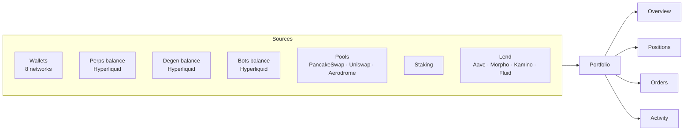
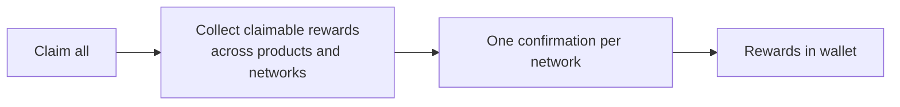

<p align="center">
  <picture>
    <source media="(prefers-color-scheme: dark)" srcset="https://docs.dyxy.io/logo/dark.svg">
    
  </picture>
</p>

# DYXY Portfolio

How the DYXY Portfolio gathers balances, positions, orders, yields and history across 8 networks and every product into one view.

> This repository describes how the product works. It does not contain DYXY source code. User guide: [docs.dyxy.io/portfolio](https://docs.dyxy.io/portfolio/overview).

## Data sources



## Tabs

| Tab | Contents |
| --- | --- |
| **Overview** | Net worth with 24h change, breakdown by category, wallet balances by network |
| **Positions** | Open perps and Degen positions, bots, pool positions, staking, lending. Contains **Claim all** |
| **Orders** | Waiting swap orders (limit, TWAP) and perps orders (limit, stop market, stop limit, TP/SL) |
| **Activity** | Every swap, trade, deposit, withdrawal, claim, bot action and approval, with explorer links and filters |

## Net worth

```
net worth = wallet balances
          + perps and Degen balances (incl. unrealized PnL)
          + bots balance and funds in bots
          + pool positions and unclaimed fees
          + staked assets and pending rewards
          + lending supplied − lending borrowed
```

## Positions by product

| Product | Fields |
| --- | --- |
| Perps and Degen mode | Size, entry, mark, PnL, liquidation price |
| Trading bots | Strategy, investment, PnL, runtime, status |
| Pools | Range status, value, unclaimed fees, rewards, APR |
| Staking | Amount, APY, pending rewards, unstaking requests |
| Lend | Supplied, borrowed, APYs, health factor |

Rewards from earn products are summed in USD, since they arrive in many tokens.

## Claim all



Claim all covers pool fees, farming rewards and staking rewards. Referral rewards are claimed on the Referrals page.

## License

Text and diagrams in this repository are licensed under [CC BY 4.0](LICENSE). The DYXY name and logo are not covered by this license.
